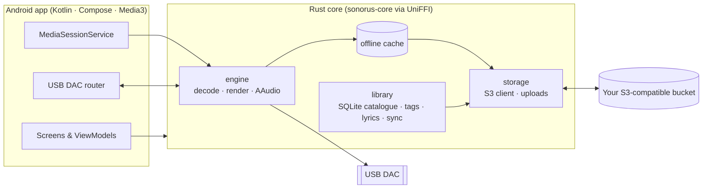

<div align="center">


# Sonorus

**A hi-res music player for Android that streams your own lossless library from S3-compatible storage, bit-perfect to your USB DAC.**

[](https://github.com/const-nishant/sonorus/actions/workflows/ci.yml)
[](https://github.com/const-nishant/sonorus/releases)
[](LICENSE)


</div>

---

Your music stays in a bucket you own: Backblaze B2, Cloudflare R2, AWS S3, MinIO or any other S3-compatible service. Sonorus indexes it, streams it on demand with range requests, keeps what you play in an offline cache, and sends the samples to a USB DAC without resampling or mixing whenever the phone allows it.

There is no Sonorus server, no account and no telemetry. The app talks only to the endpoint you configure.

## Features

**Playback**
- Bit-perfect output to USB DACs through Android's `MIXER_BEHAVIOR_BIT_PERFECT`, with exclusive AAudio streams. When the device can't play bit-perfect, Sonorus falls back to a clean float path.
- FLAC, ALAC, WAV and AIFF up to the DAC's native rate and bit depth.
- Gapless playback. Tracks with the same format share one output stream.
- ReplayGain (track or album, with a preamp and peak limiting). It applies only on the float path and never touches bit-perfect output.
- A sleep timer with a fade-out, by duration or at the end of the track.
- A signal-path view that shows source format, output format and whether the path is bit-perfect.

**Library**
- An incremental scan of your bucket with tags, artwork and embedded or `.lrc` synced lyrics.
- Albums, artists, folders, search with quality filters (hi-res, lossless, lossy), and an A–Z fast scroll.
- Smart playlists: most played, recently added, hi-res only, never played and favourites.
- Listening stats by week, month or all time.
- Playlists and favourites synced across devices through the bucket itself (`_sonorus/`).
- Uploads from the phone straight into the bucket, checked with BLAKE3.

**Offline**
- A size-capped LRU cache with an optional expiry, so a track you play twice is downloaded once.
- Download whole albums or playlists for offline use, on Wi-Fi only or on mobile data too.
- The cache is kept per bucket, so switching buckets never plays stale audio.

**Interface**
- Material 3 with a UI tinted from the artwork, a dark-first theme and the resonance-rings icon.
- A swipe-to-dismiss Now Playing screen, swipe to skip, a landscape layout and synced lyrics you can tap to seek.
- Drag to reorder and swipe to remove in the queue and playlists.

## Requirements

- Android 14 or newer on an arm64 device.
- An S3-compatible bucket and an access key that can list and read it, plus write access if you want uploads and playlist sync.
- Optional: a USB DAC. Bit-perfect output depends on the phone's support for it.

## Install

Download the latest `sonorus-vX.Y.Z.apk` from [Releases](https://github.com/const-nishant/sonorus/releases) and open it on your phone. Each release ships a `SHA256SUMS` file and a build-provenance attestation:

```sh
sha256sum -c SHA256SUMS
gh attestation verify sonorus-vX.Y.Z.apk --repo const-nishant/sonorus
```

On first launch, open **Settings → Bucket**, choose your provider and enter the endpoint, bucket, optional folder prefix and access key. Credentials are stored on the device with Android Keystore-backed encryption and are sent only to that endpoint.

## Architecture

The audio, storage and library code is a Rust core. The Android app is a thin Kotlin and Jetpack Compose shell on top of it, connected by [UniFFI](https://mozilla.github.io/uniffi-rs/).



| Crate | Role |
| --- | --- |
| [`crates/storage`](crates/storage) | S3 client (rustls), listings, ranged reads, multipart uploads |
| [`crates/engine`](crates/engine) | Symphonia decoding, the render path, ReplayGain, gapless, AAudio output, offline cache |
| [`crates/library`](crates/library) | SQLite catalogue, tag and lyrics parsing, playlists, history, smart playlists, bucket sync |
| [`crates/core`](crates/core) | The UniFFI API the app calls, background jobs and events |

## Building from source

You need Rust 1.98.1 (installed automatically from `rust-toolchain.toml`), JDK 17, the Android SDK, and NDK `28.2.13676358`.

```sh
git clone https://github.com/const-nishant/sonorus.git
cd sonorus/android
./gradlew :app:assembleDebug
```

Gradle cross-compiles the Rust core for `aarch64-linux-android` and generates the Kotlin bindings itself. Run the same checks as CI before opening a pull request:

```sh
cargo fmt --all --check
cargo clippy --workspace --all-targets -- -D warnings
cargo test --workspace
(cd android && ./gradlew :app:assembleDebug :app:lint)
```

See [CONTRIBUTING.md](CONTRIBUTING.md) for development setup and [docs/RELEASING.md](docs/RELEASING.md) for how versions and releases work.

## Security

Please report vulnerabilities privately, as described in [SECURITY.md](SECURITY.md), not in public issues.

## License

Sonorus is free software, licensed under the [GNU General Public License v3.0 or later](LICENSE).
